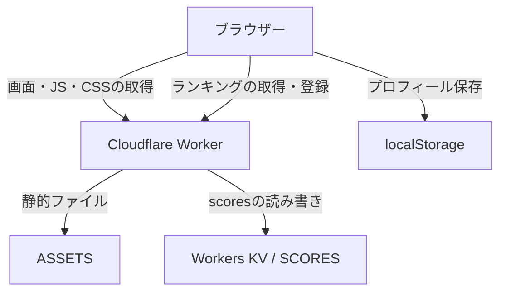
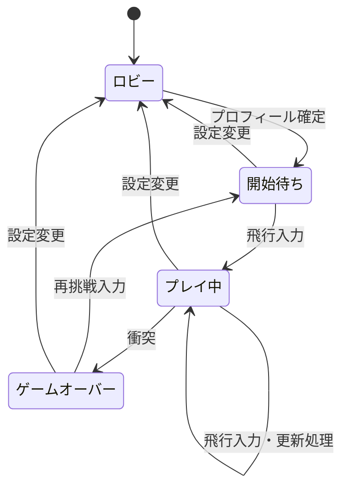
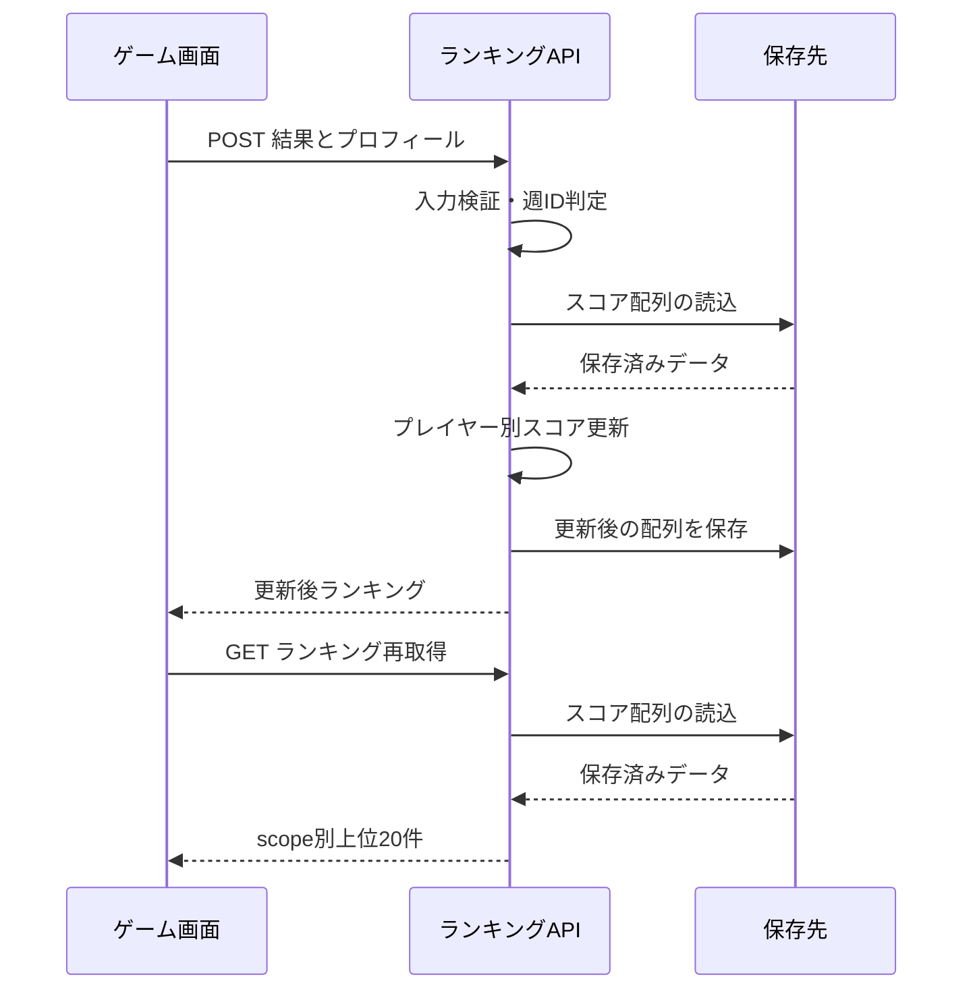

# E Flappy U 基本設計・詳細設計書

| 項目 | 内容 |
|---|---|
| 文書バージョン | 1.0 |
| 作成日 | 2026年11月19日 |
| 対象システム | E Flappy U |
| 対象ソース | `minchan3112/e-flappy-u` |
| 基準コミット | `0861b8429d58f7994bdf378612a30a57cdc77d17` |
| 文書区分 | 現行実装に基づく基本設計・詳細設計 |
| 公開先 | https://e-flappy-u.tiberius3112.workers.dev/ |
| 確認方法 | ソースコードの静的確認。稼働環境での動作試験結果は含まない。 |

## 改訂履歴

| 版 | 日付 | 改訂内容 |
|---|---|---|
| 1.0 | 2026/11/19 | 現行実装の画面、ゲーム処理、キャラクター、ランキング、API、データおよび実行環境を整理 |

## 目次

1. システム概要
2. システム構成
3. 機能一覧
4. 画面設計
5. 状態遷移・操作設計
6. ゲーム処理詳細
7. キャラクター・ステージ設計
8. ランキング設計
9. データ設計
10. API設計
11. 音声・メッセージ設計
12. モジュール構成
13. 実行・デプロイ設計
14. 確認観点
15. 参照ソース

## 1. システム概要

### 1.1 目的

社内メンバーが短時間で参加できるブラウザーゲームを提供し、スコアの比較やキャラクターの選択を通じて、社内交流のきっかけを作る。

プレイヤーは名前、所属、キャラクターを設定し、タップまたはキーボード操作でキャラクターを上昇させる。障害物を避けながら得点を獲得し、終了後にスコアをランキングへ登録する。

### 1.2 対象範囲

| 区分 | 内容 |
|---|---|
| 利用者 | 社内のプレイヤー |
| 利用方式 | Webブラウザーからアクセス |
| 入力 | ポインター操作、Spaceキー、ArrowUpキー |
| プレイヤー設定 | 名前、所属、プリセットキャラクター |
| ゲーム | 障害物回避、得点加算、難易度変化、再挑戦 |
| 成績表示 | 今週のランキング、通算ランキング、各上位20件 |
| 保存 | ブラウザー内のプロフィール、サーバー側のスコア |

名前入力はゲーム参加用のプロフィール設定であり、アカウント認証ではない。キャラクターは6種類から選択する方式とする。顔写真のアップロード、ピクセル顔の作成、任意アバターの編集は本設計の対象に含めない。

### 1.3 表示方針

- ブランド名：`EFU / E Flappy U`
- キャッチコピー：`社内チャレンジ · チームで空を飛ぼう`
- 利用案内：`社内利用専用 · 金銭・景品との交換はありません。`

## 2. システム構成

### 2.1 Cloudflare環境



| 要素 | 責務 |
|---|---|
| HTML / CSS | 画面構造、フォーム、ボタン、ランキング領域の表示 |
| JavaScript / Canvas 2D | ゲーム進行、当たり判定、描画、操作受付 |
| Web Audio API | 操作・上昇・得点・衝突の効果音 |
| Cloudflare Worker | API処理、静的アセットへのリクエスト転送 |
| Workers KV | プレイヤー別スコア配列の永続化 |
| localStorage | 同一ブラウザーでのプロフィール復元 |

### 2.2 ローカル環境

`server.mjs`が静的ファイルとランキングAPIを提供する。ランキングデータは`data/scores.json`に保存する。ランキングの入力チェック、集計、更新にはCloudflare環境と同じ`ranking-logic.js`を利用する。

## 3. 機能一覧

| 機能ID | 機能名 | 処理概要 |
|---|---|---|
| F-01 | プロフィール設定 | 名前、所属、キャラクターを設定する |
| F-02 | プロフィール保存・復元 | 設定をlocalStorageへ保存し、再訪時に読み込む |
| F-03 | キャラクター選択 | 6種類のキャラクターと対応ステージを選択する |
| F-04 | ゲーム開始 | ロビーからゲームの開始待ち状態へ移動する |
| F-05 | 飛行操作 | タップ・クリック・キー入力で上昇する |
| F-06 | 障害物・衝突判定 | 障害物を移動させ、接触時にラウンドを終了する |
| F-07 | 得点・難易度更新 | 障害物通過時に得点を加算し、速度等を変化させる |
| F-08 | 再挑戦・設定変更 | 再挑戦、またはロビーへ戻る |
| F-09 | スコア登録 | 終了時にAPIへ結果を送信する |
| F-10 | 週間ランキング | 日本時間の当週ベストで上位20件を表示する |
| F-11 | 通算ランキング | 通算ベストで上位20件を表示する |
| F-12 | 音声切替 | 効果音のオン・オフを切り替える |

## 4. 画面設計

### 4.1 画面構成

単一ページ内で中央のロビー領域とゲーム領域を切り替える。共通領域にはブランド表示、操作案内、プレイヤー情報、ランキング、音声切替を配置する。

| 画面ID | 名称 | 主な表示内容 |
|---|---|---|
| SCR-01 | ロビー | 名前・所属入力、キャラクター選択、開始ボタン |
| SCR-02 | ゲーム | Canvas、開始待ち表示、プレイ中表示、結果表示 |
| SCR-C01 | 共通領域 | ブランド、操作案内、プレイヤー情報、ランキング、音声切替 |

### 4.2 SCR-01 ロビー

| 項目ID | 項目 | 種別 | 入力・表示仕様 |
|---|---|---|---|
| L-01 | 名前 | テキスト入力 | 必須、最大20文字。前後の空白を除去し、1文字以上で開始可能 |
| L-02 | 所属 | テキスト入力 | 任意、最大24文字。前後の空白を除去 |
| L-03 | キャラクター | 選択ボタン | 6種類から1種類を選択。プレビュー、名前、ステージ名を表示 |
| L-04 | プレイをはじめる | ボタン | 入力確認後、プロフィールを保存し、ゲーム開始待ち状態へ遷移 |

キャラクターの選択内容は選択ボタン押下時にメモリー上のプレイヤー設定へ反映し、フォーム送信時にlocalStorageへ保存する。保存済みプロフィールがある場合は、読み込んだ値を初期表示に利用する。

### 4.3 SCR-02 ゲーム

| 項目ID | 項目 | 表示・動作仕様 |
|---|---|---|
| G-01 | ゲームCanvas | 内部座標480×700で背景、障害物、地面、キャラクター、HUDを描画 |
| G-02 | 開始待ち表示 | プレイヤー・テーマ情報と操作案内を表示 |
| G-03 | 得点 | 現ラウンドの得点を表示 |
| G-04 | レベル | `floor(得点 / 5) + 1`を表示 |
| G-05 | 終了表示 | ラウンド結果、BEST表示、再挑戦の案内を表示 |
| G-06 | 名前 / キャラクターを変更 | ロビーへ戻り、ラウンド状態を初期化 |

### 4.4 SCR-C01 共通領域

| 項目 | 内容 |
|---|---|
| プレイヤーカード | 名前、所属、キャラクターアイコン、キャラクター名、BEST表示 |
| ランキングタブ | 「今週」「通算」。初期選択は「今週」 |
| ランキング行 | 順位、アイコン、名前、所属、キャラクター名、対象スコア |
| 上位表示 | 1〜3位はメダル表現、4位以降は順位番号 |
| 本人表示 | 行の名前が現在の入力名と一致する場合に強調 |
| 所属未設定 | ランキングでは「社内」を表示 |
| 期間案内 | 今週は対象期間と月曜0:00（日本時間）の切替案内を表示 |
| 音声ボタン | 効果音の有効・無効を切り替える |

## 5. 状態遷移・操作設計

### 5.1 状態遷移



画面種別は`screen = lobby / game`、ラウンド状態は`mode = ready / play / over`で管理する。

### 5.2 操作受付

| 状態 | 操作 | 処理 |
|---|---|---|
| ロビー | 開始ボタン | プロフィール保存、音声初期化、開始待ちへ遷移 |
| 開始待ち | Canvasのpointerdown、Space、ArrowUp | プレイ開始、上昇速度設定 |
| プレイ中 | 同上 | 上昇速度を再設定し、上昇音を再生 |
| ゲームオーバー | 同上 | ラウンドを開始待ちへ戻す。次の飛行入力でプレイ開始 |
| ゲーム画面 | 設定変更ボタン | ロビー表示、ラウンド初期化 |
| 共通 | ランキングタブ | 対象scopeを切り替えてランキング取得 |

Space・ArrowUpはゲーム画面で受け付け、ブラウザーの既定動作を抑止する。

## 6. ゲーム処理詳細

### 6.1 基本パラメーター

以下の座標値はCanvas内部座標、速度・加速度はゲーム更新1回を単位とする。

| 項目 | 値 | 用途 |
|---|---:|---|
| Canvas幅 | 480 | 描画領域 |
| Canvas高さ | 700 | 描画領域 |
| 地面高さ | 96 | 下端の地面領域 |
| 地面上端Y | 604 | 下側境界 |
| キャラクターX | 110 | 水平方向の固定位置 |
| 初期Y | 350 | ラウンド初期位置 |
| 判定半径 | 16 | 縦方向の接触判定 |
| 横方向判定半幅 | 11.2 | `16 × 0.7` |
| 重力 | 0.42 | 垂直速度への加算値 |
| 上昇入力時の速度 | -7.4 | 上方向への速度設定 |
| 障害物幅 | 68 | 横幅 |

### 6.2 更新・描画

`requestAnimationFrame`から更新と描画を繰り返す。描画は背景、障害物、地面、キャラクター、HUDの順で行う。

プレイ中は垂直速度へ重力を加え、Y座標へ速度を反映する。障害物は左方向へ移動させる。画面外へ移動した障害物は配列から除去する。

### 6.3 難易度

得点を`s`とする。

| パラメーター | 算出式 | 特性 |
|---|---|---|
| 障害物移動速度 | `2.35 + min(s, 28) × 0.11` | 初期2.35、最大5.43 |
| 障害物の開口幅（縦） | `max(118, 168 − s × 1.5)` | 初期168、最小118 |
| 生成間隔の判定値 | `max(60, 92 − s × 0.9)` | 初期92、最小60。生成カウンターとの比較に使用 |
| 表示レベル | `floor(s / 5) + 1` | 5点ごとに1増加 |

### 6.4 障害物生成

- 新規障害物のX座標：`500`（画面幅＋20）。
- 開口部上端：上側80、地面から下側80の余白を確保する範囲で乱数決定。
- 障害物ごとに位置、開口位置、開口幅、得点処理済みフラグを保持する。
- 障害物の右端がキャラクターX座標を通過し、未加点の場合に1点を加算する。
- 同一障害物は得点処理済みフラグにより二重加算を防ぐ。

### 6.5 衝突・終了

次のいずれかでゲームオーバーとする。

1. キャラクター上端が画面上端に到達する。
2. キャラクター下端が地面上端に到達する。
3. 障害物と横方向に重なり、キャラクターが開口部内に収まらない。

終了時は衝突音、ラウンド結果表示、スコア登録、ランキング再取得を行う。`submitted`フラグにより、同一ラウンドの衝突処理から重複送信しない。

## 7. キャラクター・ステージ設計

### 7.1 選択肢

| ID | キャラクター名 | ステージ | 基本色 |
|---|---|---|---|
| `sky` | スカイ | 草原 | `#ffd166` |
| `eagle` | イーグル | 山岳 | `#8d6e63` |
| `kong` | キングコング | 都市 | `#5d4037` |
| `phoenix` | フェニックス | 火山 | `#ff7043` |
| `owl` | オウル | 夜の森 | `#a1887f` |
| `penguin` | ペンギン | 北極 | `#263238` |

キャラクター選択に応じて背景、地面、障害物装飾を切り替える。移動・衝突・得点・難易度のルールは共通とする。

### 7.2 描画・互換性

`creatures.js`の共通描画処理をゲーム本体とアイコンに利用する。Canvasの円・楕円・パスによって描画し、飛行中は羽ばたきと傾きを付ける。ランキングアイコンは32×32とする。

| 旧ID | 現行表示ID |
|---|---|
| `leaf` | `eagle` |
| `ember` | `phoenix` |
| `nova` | `owl` |
| `cloud` | `penguin` |
| 不明なID | `sky` |

旧データの表示に対応するため、旧IDを受け付ける。外観方式は`look: "preset"`、任意画像は`avatar: null`とする。

## 8. ランキング設計

### 8.1 集計条件

| 項目 | 今週 | 通算 |
|---|---|---|
| scope | `week` | `all` |
| 対象レコード | 当週のweekId、かつweeklyScoreが0より大きい | 保存された全レコード |
| 比較対象 | weeklyScore | bestScore |
| 並び順 | スコア降順、同点時は名前のlocaleCompare順 | 同左 |
| 件数 | 上位20件 | 上位20件 |

### 8.2 週の定義

日本時間（`Asia/Tokyo`）の月曜日0:00を週の開始とし、ISO週形式`YYYY-Wnn`で識別する。画面には`M/D〜M/D`形式で期間を表示する。

週の切替は現在の週IDとレコードの週IDを比較して行う。定期ジョブによる全件削除は行わず、通算ベストを保持する。

### 8.3 登録・更新

プレイヤーは名前の小文字化後の一致で識別する。

| 条件 | 更新内容 |
|---|---|
| 新規プレイヤー | bestScore、weeklyScore、lastScoreを投稿スコアで初期化 |
| 既存・同じ週 | weeklyScoreに現値と投稿値の最大値を設定 |
| 既存・別の週 | weeklyScoreを投稿値、weekIdを当週へ更新 |
| 全投稿共通 | bestScoreは現値と投稿値の最大値、lastScoreは今回値 |
| プロフィール | キャラクター情報を今回値で更新。所属は空投稿の場合、既存値を保持 |

週が変わった際、以前の週のweeklyScoreが正の値であれば`history`へ記録する。保持数は直近12件とし、過去に記録された週の履歴である。履歴閲覧用画面・APIは設けない。

## 9. データ設計

### 9.1 ブラウザープロフィール

保存先：localStorage、キー：`efu-e-flappy-u-profile`。

| フィールド | 型 | 内容 |
|---|---|---|
| name | string | 名前 |
| department | string | 所属 |
| characterId | string | 選択キャラクターID |

### 9.2 スコアレコード

Cloudflare環境ではKVバインディング`SCORES`のキー`scores`にJSON配列として保存する。ローカル環境では同じ配列を`data/scores.json`に保存する。

| フィールド | 型 | 内容 |
|---|---|---|
| name | string | プレイヤー名 |
| department | string | 所属。未設定時は空文字 |
| character | string | キャラクター表示名 |
| characterId | string | キャラクターID |
| look | string | `preset` |
| avatar | null | 任意画像は使用しない |
| bestScore | number | 通算最高点 |
| weeklyScore | number | レコードに記録された週の最高点 |
| lastScore | number | 直近の投稿点 |
| weekId | string | 対象週のISO週ID |
| history | array | 過去週の`{weekId, score}`。最大12件 |
| updatedAt | string | 最終更新日時。ISO形式 |

### 9.3 一時状態

| 状態 | 用途 |
|---|---|
| screen / mode | 表示画面・ラウンド状態 |
| birdY / birdV | キャラクターの位置・速度 |
| pipes | 表示中の障害物 |
| score / bestScore | 現ラウンド得点・画面内BEST管理 |
| frame / spawnTick | アニメーション・障害物生成のカウンター |
| submitted | ラウンド終了時の重複送信防止 |
| rankScope | 今週・通算の表示選択 |
| clouds | 背景描画用データ |

## 10. API設計

### 10.1 共通仕様

| 項目 | 内容 |
|---|---|
| パス | `/api/ranking` |
| リクエスト形式 | POST本文はJSON |
| レスポンス形式 | JSON |
| scope | `all`の場合は通算。それ以外・省略時は今週 |
| 使用メソッド | GET、POST |

### 10.2 GET：ランキング取得

例：`GET /api/ranking?scope=week`

正常時は200と次の構造を返す。以下は形式説明用のサンプル値であり、実際の利用者データではない。

```json
{
  "weekId": "2026-W47",
  "weekLabel": "11/16〜11/22",
  "scope": "week",
  "list": [
    {
      "name": "サンプル太郎",
      "department": "開発部",
      "character": "スカイ",
      "characterId": "sky",
      "look": "preset",
      "avatar": null,
      "bestScore": 30,
      "weeklyScore": 12,
      "lastScore": 12,
      "weekId": "2026-W47",
      "history": [],
      "updatedAt": "2026-11-19T09:00:00.000Z"
    }
  ]
}
```

### 10.3 POST：スコア登録

例：`POST /api/ranking?scope=week`

```json
{
  "name": "サンプル太郎",
  "department": "開発部",
  "character": "スカイ",
  "characterId": "sky",
  "score": 12
}
```

| 項目 | 入力処理 |
|---|---|
| name | 文字列化、trim、先頭20文字へ切り詰め。空文字はエラー |
| department | 文字列化、trim、先頭24文字へ切り詰め |
| score | Numberで数値化後、0〜9999の整数であることを確認 |
| characterId | 現行ID・互換IDを確認。不明な値はsky |
| look / avatar | サーバー側でpreset / nullに設定 |

正常時は保存後のランキングをGETと同じ形式で返す。返却対象はscopeに従うが、保存時は週間・通算の両方を更新する。

### 10.4 HTTPステータス

| ステータス | 条件 | error値 |
|---|---|---|
| 200 | 取得・登録成功 | なし |
| 400 | JSON解析不可 | `JSONが不正です` |
| 400 | 名前・スコア不正 | `名前またはスコアが不正です` |
| 405 | GET・POST以外 | `Method not allowed` |
| 500 | CloudflareでPOST時にSCORES未設定 | `ランキングストレージが未設定です` |

CloudflareでSCORES未設定の場合、GETの読み込み処理は空配列を返す。ローカルのファイル読み込みでは、未作成・読込不可・不正データの場合に空配列を使用する。

### 10.5 登録処理の流れ



## 11. 音声・メッセージ設計

### 11.1 効果音

Web Audio APIで音を生成する。ユーザー操作時にAudioContextを初期化・再開する。ミュート時は効果音を生成しない。

| イベント | 音の概要 |
|---|---|
| UI操作 | 短い三角波 |
| 上昇 | 周波数が上がる矩形波 |
| 得点 | 660Hz・880Hzの2音 |
| 衝突 | 周波数が下がる鋸歯状波 |

### 11.2 表示メッセージ

| 条件 | 表示 |
|---|---|
| ランキング取得失敗 | 社内ランキングに接続できません。 |
| スコア保存失敗 | スコアをサーバーに保存できませんでした。 |
| 今週のデータなし | 今週はまだスコアがありません。最初の1人になりましょう！ |
| 通算のデータなし | まだスコアがありません。最初の1人になりましょう！ |

ランキング表示へ挿入する文字列はHTMLエスケープを行う。プロフィール読み込み時にJSON解析が失敗した場合は、例外を捕捉して処理を継続する。

## 12. モジュール構成

| ファイル | 主な責務 |
|---|---|
| `index.html` | 画面要素、プロフィールフォーム、Canvas、ランキング領域 |
| `styles.css` | レイアウト、配色、各UI要素のスタイル |
| `game.js` | 状態管理、入力、物理更新、衝突、得点、API連携 |
| `brand.js` | ブランド情報、キャラクター定義 |
| `creatures.js` | キャラクターの共通Canvas描画 |
| `avatar.js` | キャラクター解決、互換ID処理、アイコン描画 |
| `themes.js` | ステージ別背景・地面・障害物の描画 |
| `audio.js` | 効果音生成、ミュート管理 |
| `ranking.js` | API呼出し、ランキング行生成、エスケープ |
| `ranking-logic.js` | 週判定、検証、順位計算、レコード更新 |
| `worker.js` | Cloudflare Workersのルーティング、KVアクセス |
| `server.mjs` | ローカルHTTPサーバー、ファイル保存 |
| `wrangler.toml` | Worker、静的アセット、KVバインディング設定 |
| `package.json` | 実行コマンド、開発依存関係 |

## 13. 実行・デプロイ設計

### 13.1 実行コマンド

| 用途 | コマンド | 補足 |
|---|---|---|
| 依存関係導入 | `npm install` | package.jsonに従って導入 |
| ローカル起動 | `npm run dev` | `node server.mjs`。標準ポート5173、PORTで変更可能 |
| Cloudflare用開発 | `npm run dev:cf` | `wrangler dev` |
| デプロイ | `npm run deploy` | `wrangler deploy` |

この文書の作成に伴うデプロイや保存済みランキングの変更は行っていない。

### 13.2 Worker設定

| 設定 | 値 |
|---|---|
| name | `e-flappy-u` |
| main | `worker.js` |
| compatibility_date | `2026-11-01` |
| 静的アセットのディレクトリ | `.` |
| 静的アセットのバインディング | `ASSETS` |
| Workerを先に実行するパス | `/api/*` |
| KVバインディング | `SCORES` |

`/api/ranking`をランキングAPIとして処理し、それ以外は静的アセットへ転送する。KVの名前空間は環境設定に従って接続する。

## 14. 確認観点

以下は本設計に対応する確認項目であり、実施済みの試験結果ではない。

| ID | 対象 | 確認内容・期待結果 |
|---|---|---|
| T-01 | プロフィール | 名前が空または空白のみの場合、プレイを開始しない |
| T-02 | プロフィール | 名前・所属・選択キャラクターを保存し、再読込後に復元できる |
| T-03 | キャラクター | 6種類の選択に応じてキャラクターとステージが切り替わる |
| T-04 | 操作 | Canvas操作、Space、ArrowUpで開始・上昇できる |
| T-05 | 衝突 | 障害物・天井・地面への接触で終了する |
| T-06 | 得点 | 未加点の障害物通過で1点加算し、同一障害物で重複加算しない |
| T-07 | 難易度 | 得点に応じて速度、開口幅、生成間隔、表示レベルが変わる |
| T-08 | 再挑戦 | 終了後の入力で開始待ちに戻り、次の入力で開始する |
| T-09 | スコア | 新規投稿でレコードを作成し、低得点の再投稿でも最高点を維持する |
| T-10 | 週切替 | 日本時間の日曜23:59と月曜0:00で対象週が切り替わる |
| T-11 | 年跨ぎ | 年末・年始のISO週IDと対象期間が正しい |
| T-12 | ランキング | 対象スコア降順、同点時の名前順、最大20件で表示する |
| T-13 | 0点 | 登録可能。週間ランキングの抽出対象からは外れる |
| T-14 | API境界値 | 0・9999を受理し、負数・10000・小数を拒否する |
| T-15 | API異常 | 不正JSONは400、非対応メソッドは405を返す |
| T-16 | 通信異常 | ランキング取得・スコア保存失敗時に対応メッセージを表示する |
| T-17 | 表示文字 | 特殊文字を含む名前・所属を文字列として表示する |
| T-18 | 音声 | 音声切替で効果音の有効・無効が変わる |
| T-19 | 互換性 | 旧キャラクターIDを現行キャラクターとして表示できる |
| T-20 | 週履歴 | 週変更時に以前の正の週間スコアを履歴へ移し、最大12件を保持する |

## 15. 参照ソース

本書の基準は次のコミットとする。公開URLの稼働版とこのコミットの一致確認は、本書の静的確認範囲に含めない。

- [対象コミット](https://github.com/minchan3112/e-flappy-u/tree/0861b8429d58f7994bdf378612a30a57cdc77d17)
- [ゲーム制御：game.js](https://github.com/minchan3112/e-flappy-u/blob/0861b8429d58f7994bdf378612a30a57cdc77d17/game.js)
- [画面構造：index.html](https://github.com/minchan3112/e-flappy-u/blob/0861b8429d58f7994bdf378612a30a57cdc77d17/index.html)
- [ランキング集計：ranking-logic.js](https://github.com/minchan3112/e-flappy-u/blob/0861b8429d58f7994bdf378612a30a57cdc77d17/ranking-logic.js)
- [ランキング画面：ranking.js](https://github.com/minchan3112/e-flappy-u/blob/0861b8429d58f7994bdf378612a30a57cdc77d17/ranking.js)
- [キャラクター定義：brand.js](https://github.com/minchan3112/e-flappy-u/blob/0861b8429d58f7994bdf378612a30a57cdc77d17/brand.js)
- [Worker：worker.js](https://github.com/minchan3112/e-flappy-u/blob/0861b8429d58f7994bdf378612a30a57cdc77d17/worker.js)
- [ローカルサーバー：server.mjs](https://github.com/minchan3112/e-flappy-u/blob/0861b8429d58f7994bdf378612a30a57cdc77d17/server.mjs)
- [環境設定：wrangler.toml](https://github.com/minchan3112/e-flappy-u/blob/0861b8429d58f7994bdf378612a30a57cdc77d17/wrangler.toml)

